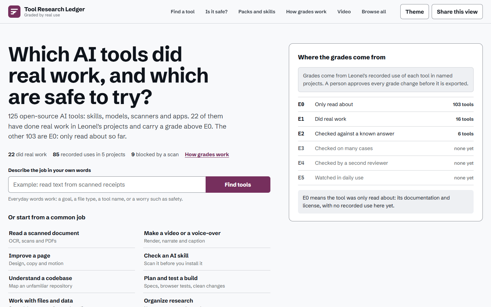
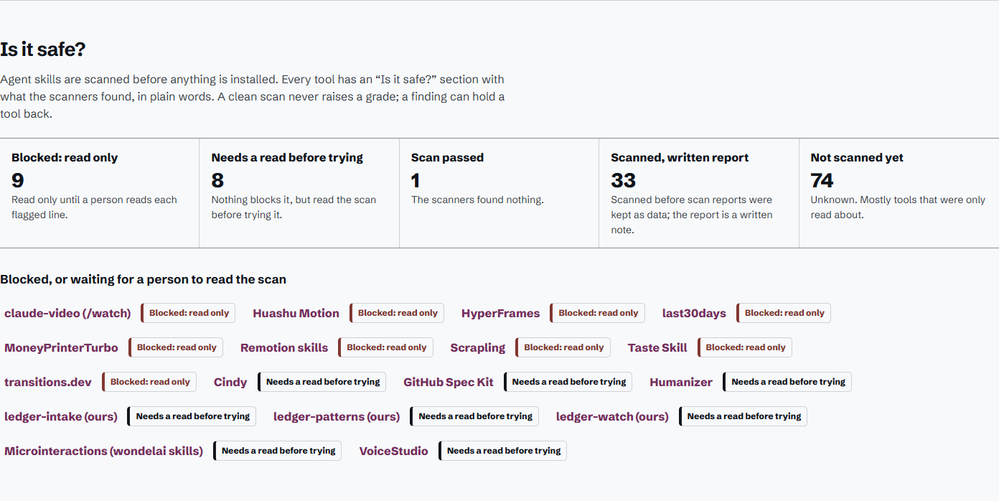
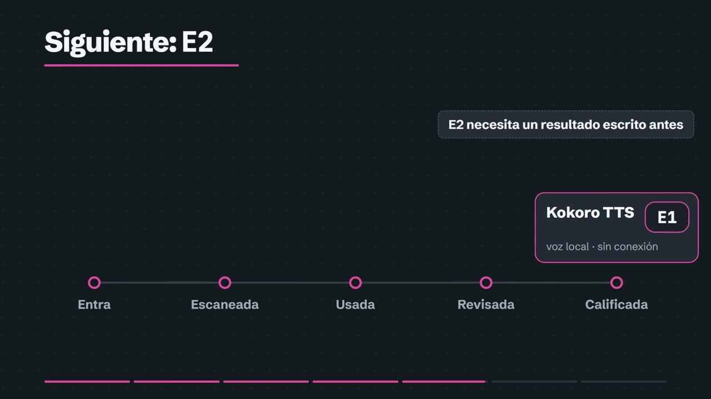

<a href="https://leonelivancortesrodriguez.github.io/tool-research-ledger/"></a>

# Tool Research Ledger

Un registro público de 125 herramientas de inteligencia artificial de código abierto, cada una calificada solo por lo que ha hecho en los proyectos de Leonel. Es para quien elige una herramienta de IA y quiere pruebas en vez de popularidad, y para quien quiere ver cómo Leonel toma esa decisión.

**[Abrir el registro en vivo](https://leonelivancortesrodriguez.github.io/tool-research-ledger/)** (en inglés) · [Ver la historia (3:09, con subtítulos)](docs/video/story-es.mp4) · [English](README.md)

## El problema

Cada semana aparecen nuevas herramientas de IA: habilidades, modelos, escáneres, agentes. Todas prometen un mejor trabajo. Las estrellas y los anuncios dicen que una herramienta es popular. No dicen si funciona, si es segura de instalar o si le sirve al proyecto que tienes enfrente. Leonel reunió 125 de estas herramientas y necesitaba una forma honesta de saber cuáles se habían ganado un lugar.

## La respuesta: una nota que solo las pruebas pueden subir

Cada herramienta tiene una nota. Leer sobre ella, instalarla o escanearla nunca la sube. Solo la sube un uso registrado en un proyecto real, y una persona aprueba cada cambio.

| En palabras simples | Nota | Herramientas hoy |
|---|---|---|
| Solo leída | E0 | 103 |
| Hizo trabajo real en un proyecto con nombre | E1 | 16 |
| Comprobada con un resultado escrito antes | E2 | 6 |
| Comprobada en muchos casos | E3 | 0 |
| Revisada por otra persona | E4 | 0 |
| Vigilada en uso diario | E5 | 0 |

Junto a la nota, cada herramienta tiene una decisión: usarla (IMPLEMENT), usarla dentro de límites (CONDITIONAL), en prueba (PILOT), solo lectura, sin instalar (REFERENCE), en observación (WATCH), en pausa (HOLD), no es para nosotros (REJECT). La nota dice cuánta prueba hay; la decisión dice qué puedes hacer ahora con la herramienta.

## Se escanea antes de instalar cualquier cosa

Antes de instalar una habilidad o un repositorio, un escáner lee sus archivos buscando contraseñas robadas, instrucciones ocultas o código descargado de internet. Cada hallazgo trae su gravedad y su número de línea, para que una persona lo revise. En 24 de 51 escaneos, al menos una parte no era segura. Esas partes no se instalan hasta que una persona lee el informe y decide.

También se probó el escáner, con cinco casos plantados que no conocía. Calificó dos trampas solo como precaución: una que envía tus contraseñas de la nube a un extraño y otra que le dice al agente que ignore sus reglas. Desde entonces el registro bloquea cualquier hallazgo de alto riesgo hasta que una persona lo lea.

En el sitio, cada herramienta tiene una sección "Is it safe?" (¿Es segura?) que dice en palabras simples lo que encontraron los escáneres. Hoy hay 9 herramientas bloqueadas (solo lectura hasta que una persona lea cada línea marcada), 8 que piden una lectura antes de probarlas, 34 con un escaneo registrado y 74 sin escanear todavía.



## Una herramienta, de principio a fin

La voz que narra el video es Kokoro TTS, un modelo de texto a voz que funciona sin conexión en la computadora de Leonel. Este es su camino por el registro, el mismo que sigue cada herramienta:

1. Entró al registro en E0, sin pruebas: solo se habían leído su documentación y su licencia.
2. Se escaneó. El escaneo no encontró problemas conocidos, y sus archivos de modelo coincidieron con sus huellas publicadas.
3. Se usó. Grabó la primera narración del video, y ese uso real propuso E1.
4. Leonel revisó el registro y aprobó la subida a E1 el 2026-10-28.
5. Para llegar a E2, necesita una comprobación contra un resultado escrito antes de usarla.



## Aprende sobre la marcha

Cada uso queda escrito: la tarea, lo que falló, lo que se arregló y la evidencia. En 85 usos dentro de 5 proyectos hay 77 problemas registrados y 66 arreglos. Un ejemplo: FFmpeg midió el primer borrador del video y encontró el sonido demasiado bajo, -21.2 LUFS contra un objetivo de -16. Se corrigió el sonido, y esa comprobación, con su resultado esperado escrito antes, subió FFmpeg a E2.

Una comprobación fallida puede volverse una regla nueva, como la regla de escaneo más estricta. Cuando una herramienta enseña una buena idea pero no es segura o es más de lo que la tarea pide, la idea se reconstruye como una habilidad propia del registro:

- ledger-watch revisa un video con cuadros de muestra y sus palabras habladas. La idea vino de claude-video, que no se instaló porque sube el video a Google Gemini y puede leer las cookies del navegador.
- ledger-patterns revisa línea por línea una lista de familias de ataque (espionaje, robo de datos, inyección, cadena de suministro), para no depender de un solo escáner. Aprendida de NVIDIA SkillSpector.
- ledger-intake repite los mismos pasos con cada herramienta nueva: fijar la versión, escanear, filtrar, entrar en E0, esperar a una persona. Aprendida de SkillSpector y GitHub Spec Kit.

Los paquetes agrupan herramientas que ya trabajaron juntas: Story video (HyperFrames, Kokoro TTS, FFmpeg, ledger-watch, PaddleOCR, transitions.dev, Huashu Motion), Tool intake y Ledger pages. Cuando empieza un proyecto nuevo, el registro sugiere las herramientas que encajan y cómo se probará cada una ahí.

## Pruébalo

En el [registro en vivo](https://leonelivancortesrodriguez.github.io/tool-research-ledger/) (en inglés) puedes:

- Describir una tarea con palabras de todos los días, como "read text from scanned receipts", o elegir una de ocho tareas comunes. Recibes hasta tres herramientas, cada una con su nota y lo que puedes hacer con ella.
- Abrir cualquier herramienta y leer su sección "Is it safe?".
- Elegir un paquete de herramientas que trabajan juntas y ver las habilidades hechas aquí, con lo que se aprendió de cada una.
- Ver las 22 herramientas con nota, los proyectos donde trabajaron y cada uso registrado.
- Ver la historia en español o en inglés, con subtítulos y el guion en la página.

## Pruebas y comprobaciones

Los datos son una exportación del registro de origen de Leonel, depurado antes de publicarse ([`data/ledger-export.json`](data/ledger-export.json)). `node scripts/import-export.mjs` la convierte en el catálogo que lee la página, y `npm test` falla si alguna nota, decisión, nota de seguridad o uso registrado difiere de la exportación.

Cada número del video sale de la exportación, leído por [`video/story.mjs`](video/story.mjs). La narración en español solo dice palabras en español; los nombres en inglés quedan en pantalla. Cada comprobación se escribió con su resultado esperado, se guardó en git y solo después se ejecutó: [palabras habladas](docs/checks/2026-10-28-round2-spoken-words.md), [palabras en pantalla](docs/checks/2026-10-28-round2-frames.md), [volumen](docs/checks/2026-10-28-round2-loudness.md), [pruebas completas](docs/checks/2026-10-28-round2-tests.md) y [privacidad](docs/checks/2026-10-28-round2-privacy.md). Archivos del video: [Español](docs/video/story-es.mp4) ([subtítulos](docs/video/captions-es.vtt)) · [English](docs/video/story-en.mp4) ([captions](docs/video/captions-en.vtt)).

## El papel de Leonel

Leonel definió el objetivo del producto, fijó los criterios de investigación y aceptación, usó las herramientas en los proyectos que nombra cada registro y aprobó cada cambio de nota. Agentes de programación ayudaron a construir la interfaz, las pruebas, el proceso del video y el paquete de publicación.

## Limitaciones

Las notas cubren solo los usos registrados en los proyectos de Leonel; una herramienta que funcionó ahí puede no servir en el tuyo. Ninguna herramienta está por encima de E2. Las notas de seguridad describen lo que encontraron los escáneres, no son una certificación de seguridad. Cada adopción necesita su propia revisión legal, de seguridad y operativa.

## Ejecutar y verificar

Requisitos: Node.js 20+ y Chrome, Edge o un Chromium compatible con Playwright.

```powershell
npm ci
npm run start      # http://127.0.0.1:4173; index.html también funciona directamente
npm run verify     # estática, mutación, contraste, prosa, navegador, privacidad, build
```

Reconstruir el video necesita FFmpeg, una voz local de Kokoro, HyperFrames y GSAP; [`video/build.mjs`](video/build.mjs) nombra las variables de entorno que apuntan a ellos.

## Licencia

El código y la documentación originales se publican bajo la [licencia MIT](LICENSE). Schibsted Grotesk se incluye bajo la SIL Open Font License. Los proyectos de terceros conservan sus propias licencias y marcas.
