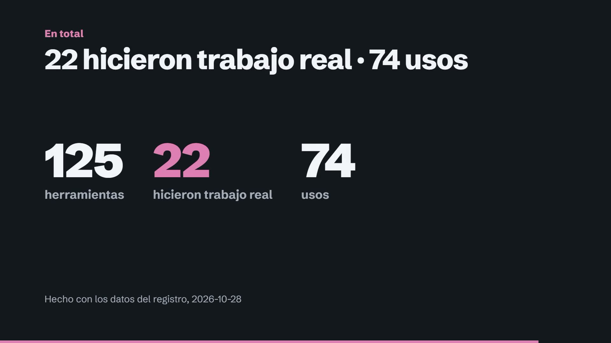

<a href="docs/video/story-es.mp4"></a>

**[Abrir el ledger en vivo](https://leonelivancortesrodriguez.github.io/tool-research-ledger/)** · [Ver la historia en 97 segundos](docs/video/story-es.mp4) ([subtítulos](docs/video/captions-es.vtt)) · [Ejecutarlo localmente](#ejecutar-y-verificar) · [English](README.md)

¿Qué herramientas de IA de código abierto hicieron trabajo real, y cuáles es seguro probar? El ledger guarda 125 herramientas. 22 tienen una nota por encima de E0 (16 en E1, 6 en E2), ganada con 74 usos registrados en 5 proyectos con nombre. Las otras 103 están en E0: por ahora solo se ha leído sobre ellas.

La interfaz y la documentación técnica están en inglés.

## De dónde salen las notas

Una nota sale del uso registrado de una herramienta en un proyecto con nombre: la tarea, el resultado, qué salió mal y cómo se arregló. Una persona aprueba cada cambio de nota antes de exportarlo. Leer la documentación de una herramienta, instalarla o escanearla nunca sube su nota.

Los datos son una exportación del ledger privado del dueño, limpiada antes de publicarla ([`data/ledger-export.json`](data/ledger-export.json)). `node scripts/import-export.mjs` la convierte en el catálogo que lee la página, y `npm test` falla si alguna nota, decisión o nota de seguridad difiere de la exportación.

## Qué permite hacer la página

- Encontrar una herramienta para un trabajo. Descríbelo con tus palabras ("leer texto de recibos escaneados", en inglés) o elige uno de ocho trabajos comunes. Recibes hasta tres herramientas, cada una con su nota y lo que puedes hacer con ella.
- Ver si una herramienta es segura. Cada herramienta tiene una sección "Is it safe?": lo que encontraron los escáneres, en palabras simples. 9 herramientas están bloqueadas hasta que una persona lea cada línea marcada.
- Tomar el conjunto de herramientas para un tipo de trabajo. Tres paquetes de herramientas que funcionan juntas, y tres habilidades construidas aquí con ideas que enseñaron otras herramientas, con la razón para no instalar la original.
- Ver qué hizo trabajo real. Las 22 herramientas con nota, los proyectos donde trabajaron y cada uso registrado.

## Cómo leer una nota

| Nota | En palabras simples | Herramientas |
|---|---|---|
| E0 | Solo leída | 103 |
| E1 | Hizo trabajo real en un proyecto con nombre | 16 |
| E2 | Comprobada con una respuesta escrita antes | 6 |
| E3 | Comprobada en muchos casos | 0 |
| E4 | Revisada por otra persona | 0 |
| E5 | Vigilada en uso diario | 0 |

Junto a la nota, cada herramienta tiene una decisión: usarla (IMPLEMENT), usarla dentro de límites (CONDITIONAL), en prueba (PILOT), solo lectura, sin instalar (REFERENCE), en observación (WATCH), en pausa (HOLD), no es para nosotros (REJECT). La nota dice cuánta prueba hay; la decisión dice qué puedes hacer ahora.

## El video

97 segundos en español y 90 en inglés, con subtítulos, sobre cómo una herramienta gana E1 y E2 aquí: la voz que lo narra, un lector de texto que leyó 32 de 32 titulares contra una respuesta escrita antes, y una comprobación de un escáner que falló y quedó registrada. La narración en español solo dice palabras en español; los nombres en inglés quedan en pantalla. Cada número se calcula desde `data/catalog.json` con [`video/story.mjs`](video/story.mjs). [Español](docs/video/story-es.mp4) · [English](docs/video/story-en.mp4). Comprobaciones: [palabras habladas](docs/checks/2026-10-28-spoken-words.md), [palabras en pantalla](docs/checks/2026-10-28-frames.md), [volumen](docs/checks/2026-10-28-loudness.md).

## El papel de Leonel

Leonel definió el objetivo del producto, fijó los criterios de investigación y aceptación, usó las herramientas en los proyectos que nombra cada registro y aprobó cada cambio de nota. Agentes de programación ayudaron a construir la interfaz, las pruebas, el proceso del video y el paquete de publicación.

## Ejecutar y verificar

Requisitos: Node.js 20+ y Chrome, Edge o un Chromium compatible con Playwright.

```powershell
npm ci
npm run start      # http://127.0.0.1:4173; index.html también funciona directamente
npm run verify     # estático, mutación, contraste, prosa, navegador, privacidad, paquete
```

Reconstruir el video necesita FFmpeg, una voz Kokoro local, HyperFrames y GSAP; [`video/build.mjs`](video/build.mjs) nombra las variables de entorno que apuntan a ellos. Los resultados de cada comprobación, con lo esperado escrito antes, están en [`docs/checks/`](docs/checks/).

## Limitaciones

Las notas cubren solo los usos registrados en los proyectos del dueño; una herramienta que funcionó ahí puede no servir en el tuyo. Ninguna herramienta está por encima de E2. Las notas de seguridad describen lo que encontraron los escáneres, no una certificación. Cada adopción necesita su propia revisión legal, de seguridad y operativa.

## Licencia

El código y la documentación originales se publican bajo la [licencia MIT](LICENSE). Schibsted Grotesk se incluye bajo la SIL Open Font License. Los proyectos de terceros conservan sus propias licencias y marcas.
