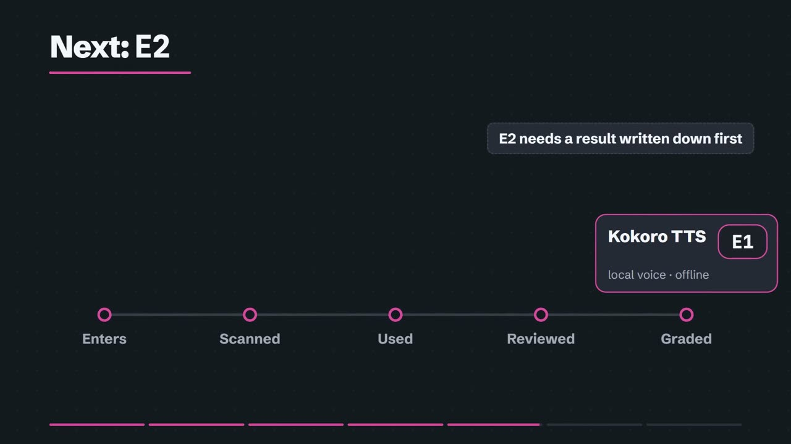

<a href="https://leonelivancortesrodriguez.github.io/tool-research-ledger/"></a>

# Tool Research Ledger

A public record of 125 open-source AI tools, each graded only by what it has done in Leonel's own projects. It is for anyone choosing an AI tool who wants proof instead of popularity, and for anyone who wants to see how Leonel makes that choice.

**[Open the live ledger](https://leonelivancortesrodriguez.github.io/tool-research-ledger/)** · [Watch the story (2:56, with captions)](docs/video/story-en.mp4) · [Español](README.es.md)

## The problem

New AI tools appear every week: skills, models, scanners, agents. Each one promises better work. Stars and launch posts tell you a tool is popular. They do not tell you whether it works, whether it is safe to install, or whether it fits the project in front of you. Leonel collected 125 of these tools and needed an honest way to tell which ones had earned a place.

## The answer: a grade only proof can raise

Every tool gets a grade. Reading about a tool, installing it or scanning it never raises the grade. Only recorded use in a real project does, and a person approves every change.

| In plain words | Grade | Tools now |
|---|---|---|
| Only read about | E0 | 103 |
| Did real work in a named project | E1 | 16 |
| Checked against a result written down first | E2 | 6 |
| Checked on many cases | E3 | 0 |
| Checked by a second reviewer | E4 | 0 |
| Watched in daily use | E5 | 0 |

Beside the grade, each tool has a decision in plain words: Use it (IMPLEMENT), Use within limits (CONDITIONAL), Trying it (PILOT), Read only, not installed (REFERENCE), Watching (WATCH), On hold (HOLD), Not for us (REJECT). The grade says how much proof there is; the decision says what you may do with the tool now.

## Scanned before anything is installed

Before a skill or repository is installed, a scanner reads its files, looking for stolen passwords, hidden instructions and code pulled from the internet. Each finding comes with a severity and a line number, so a person can check it. In 24 of 51 scans, at least one part was not safe. Those parts are not installed unless a person reads the report and decides.

The scanner was tested as well, with five planted cases it was not told about. It rated two traps as only a caution: one that sends your cloud passwords to a stranger, and one that tells the agent to ignore its rules. Since then the ledger blocks any high-risk finding until a person reads it.

On the site, every tool has an "Is it safe?" section that says in plain words what the scanners found. Today 9 tools are blocked (read only until a person reads each flagged line), 8 need a read before trying, 34 have a scan on file and 74 have not been scanned yet.


## One tool, start to finish

The voice that narrates the story video is Kokoro TTS, a text-to-speech model that runs offline on Leonel's computer. This is its path through the ledger, the same one every tool follows:

1. It entered the ledger at E0, with no proof: only its documentation and license had been read.
2. It was scanned. The scan found no known problems, and its model files matched their published fingerprints.
3. It was used. It recorded the first narration of the story video, and that real use proposed E1.
4. Leonel reviewed the record and approved the move to E1 on 2026-10-28.
5. To reach E2, it needs a check against a result written down before it runs.



## It learns as it goes

Every use is written down: the task, what broke, what was fixed and the evidence. Across 85 uses in 5 projects, 77 problems are on record, with 66 fixes. One example: FFmpeg measured the first draft of the story video and found its sound too quiet, at -21.2 LUFS against a target of -16. The sound was fixed, and that check, with its expected result written first, moved FFmpeg to E2.

A failed check can become a new rule, like the stricter scan rule above. When a tool teaches a good idea but is unsafe or more than the job needs, the idea is rebuilt as one of the ledger's own skills:

- ledger-watch checks a video from sampled frames plus its spoken words. The idea came from claude-video, which was not installed because it uploads the video to Google Gemini and can read browser cookies.
- ledger-patterns checks a named list of attack families line by line (snooping, exfiltration, injection, supply chain), so the ledger does not depend on one scanner. Learned from NVIDIA SkillSpector.
- ledger-intake repeats the same steps for every new tool: pin the version, scan, gate, enter at E0, wait for a person. Learned from SkillSpector and GitHub Spec Kit.

Packs group tools that have worked together: Story video (HyperFrames, Kokoro TTS, FFmpeg, ledger-watch, PaddleOCR, transitions.dev, Huashu Motion), Tool intake and Ledger pages. When a new project starts, the ledger suggests the tools that fit it and how each one will be tested there.

## Try it

On the [live ledger](https://leonelivancortesrodriguez.github.io/tool-research-ledger/) you can:

- Describe a job in everyday words, such as "read text from scanned receipts", or pick one of eight common jobs. You get up to three tools, each with its grade and what you may do with it.
- Open any tool and read its "Is it safe?" section.
- Pick a pack of tools that work together, and see the skills built here with what they were learned from.
- See the 22 graded tools, the projects they worked in and every recorded use.
- Watch the story in English or Spanish, with captions and the script on the page.

## Proof and checks

The data is an export of Leonel's source ledger, cleaned before publication ([`data/ledger-export.json`](data/ledger-export.json)). `node scripts/import-export.mjs` turns it into the catalog the page reads, and `npm test` fails if any grade, decision, safety note or recorded use differs from the export.

Every number in the story video is read from the export by [`video/story.mjs`](video/story.mjs). Each check was written down with its expected result, committed, and only then run: [spoken words](docs/checks/2026-10-28-round2-spoken-words.md), [on-screen words](docs/checks/2026-10-28-round2-frames.md), [loudness](docs/checks/2026-10-28-round2-loudness.md), [full test run](docs/checks/2026-10-28-round2-tests.md) and [privacy](docs/checks/2026-10-28-round2-privacy.md). Video files: [English](docs/video/story-en.mp4) ([captions](docs/video/captions-en.vtt)) · [Español](docs/video/story-es.mp4) ([subtítulos](docs/video/captions-es.vtt)).

## Leonel's role

Leonel defined the product goal, set the research and acceptance criteria, used the tools in the projects each record names, and approved every grade change. Coding agents helped build the interface, tests, video pipeline and release package.

## Limitations

Grades cover only the uses recorded in Leonel's projects; a tool that worked there may not fit yours. No tool is above E2. Safety notes describe what the scanners found, not a security certification. Each adoption still needs its own legal, security and operational review.

## Run and verify

Requirements: Node.js 20+ and Chrome, Edge, or a Playwright-compatible Chromium.

```powershell
npm ci
npm run start      # http://127.0.0.1:4173; index.html also works directly
npm run verify     # static, mutation, contrast, prose, browser, privacy, build
```

Rebuilding the video needs FFmpeg, a local Kokoro voice, HyperFrames and GSAP; [`video/build.mjs`](video/build.mjs) names the environment variables that point at them.

## License

The original code and documentation are released under the [MIT License](LICENSE). Schibsted Grotesk is bundled under the SIL Open Font License. Third-party projects keep their own licenses and trademarks.
