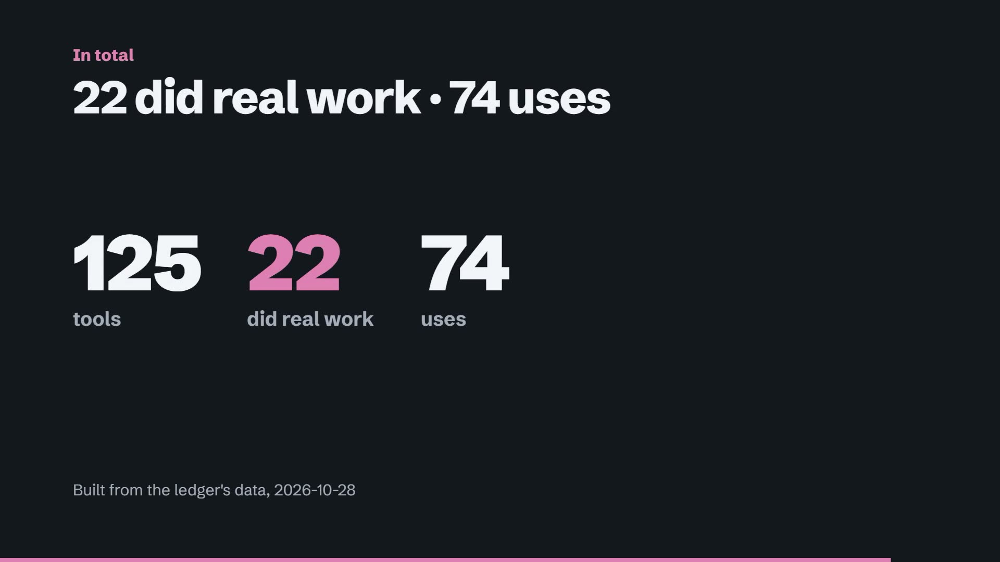

<a href="docs/video/story-en.mp4"></a>

**[Open the live ledger](https://leonelivancortesrodriguez.github.io/tool-research-ledger/)** · [Watch the 90-second story](docs/video/story-en.mp4) ([captions](docs/video/captions-en.vtt)) · [Run it locally](#run-and-verify) · [Español](README.es.md)

Which open-source AI tools did real work, and which are safe to try? The ledger keeps 125 tools. 22 of them carry a grade above E0 (16 at E1, 6 at E2), earned through 74 recorded uses in 5 named projects. The other 103 are E0: only read about so far.

## Where the grades come from

A grade comes from the owner's recorded use of a tool in a named project: the task, the result, what went wrong and how it was fixed. A person approves every grade change before it is exported. Reading a tool's documentation, installing it or scanning it never raises its grade.

The data is an export of the owner's private ledger, cleaned before publication ([`data/ledger-export.json`](data/ledger-export.json)). `node scripts/import-export.mjs` turns it into the catalog the page reads, and `npm test` fails if any grade, decision or safety note differs from the export.

## What the page lets you do

- Find a tool for a job. Describe it in everyday words ("read text from scanned receipts") or pick one of eight common jobs. You get up to three tools, each with its grade and what you may do with it.
- Check whether a tool is safe. Every tool has an "Is it safe?" section: what the scanners found, in plain words. 9 tools are blocked until a person reads each flagged line.
- Get the tool set for a kind of work. Three packs of tools that work together, and three skills built here from ideas other tools taught, with why the original was not installed.
- See what did real work. The 22 graded tools, with the projects they worked in and every recorded use.

## How to read a grade

| Grade | In plain words | Tools |
|---|---|---|
| E0 | Only read about | 103 |
| E1 | Did real work in a named project | 16 |
| E2 | Checked against a known answer written down first | 6 |
| E3 | Checked on many cases | 0 |
| E4 | Checked by a second reviewer | 0 |
| E5 | Watched in daily use | 0 |

Beside the grade, each tool has a decision in plain words: Use it (IMPLEMENT), Use within limits (CONDITIONAL), Trying it (PILOT), Read only, not installed (REFERENCE), Watching (WATCH), On hold (HOLD), Not for us (REJECT). The grade says how much proof there is; the decision says what you may do now.

## The story video

90 seconds in English and 97 in Spanish, with captions, on how a tool earns E1 and E2 here: the voice that narrates it, a text reader that read 32 of 32 headlines against an answer written first, and a scanner check that failed and was kept on record. Every number is computed from `data/catalog.json` by [`video/story.mjs`](video/story.mjs). [English](docs/video/story-en.mp4) · [Español](docs/video/story-es.mp4). Checks: [spoken words](docs/checks/2026-10-28-spoken-words.md), [on-screen words](docs/checks/2026-10-28-frames.md), [loudness](docs/checks/2026-10-28-loudness.md).

## Leonel's role

Leonel defined the product goal, set the research and acceptance criteria, used the tools in the projects each record names, and approved every grade change. Coding agents helped build the interface, tests, video pipeline and release package.

## Run and verify

Requirements: Node.js 20+ and Chrome, Edge, or a Playwright-compatible Chromium.

```powershell
npm ci
npm run start      # http://127.0.0.1:4173; index.html also works directly
npm run verify     # static, mutation, contrast, prose, browser, privacy, build
```

Rebuilding the video needs FFmpeg, a local Kokoro voice, HyperFrames and GSAP; [`video/build.mjs`](video/build.mjs) names the environment variables that point at them. Check results with what was expected beforehand are in [`docs/checks/`](docs/checks/).

## Limitations

Grades cover only the uses recorded in the owner's projects; a tool that worked there may not fit yours. No tool is above E2. Safety notes describe what the scanners found, not a security certification. Each adoption still needs its own legal, security and operational review.

## License

The original code and documentation are released under the [MIT License](LICENSE). Schibsted Grotesk is bundled under the SIL Open Font License. Third-party projects keep their own licenses and trademarks.
