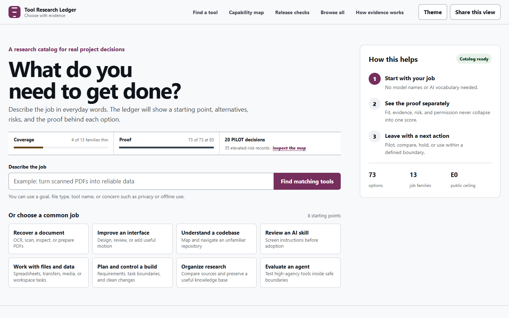

# Tool Research Ledger

A decision workspace for comparing open-source tools by job, available evidence, adoption limits, and risk.

**[View the live demo](https://leonelivancortesrodriguez.github.io/tool-research-ledger/)** · [Inspect the method](docs/METHODOLOGY.md)



## Why this exists

Repository lists show what is popular. This ledger records what someone may safely do next and what evidence supports that action. Fit, evidence, decision, and risk remain separate, which makes weak proof easier to spot.

This edition expands the original 71-tool, 12-family baseline to 73 tools across 13 capability families. The two new source-reviewed entries are [Berth](https://github.com/T-Crypt/berth) and [SWE-AF](https://github.com/Agent-Field/SWE-AF). Counts on the page come from the same catalog used by the filters and detail views.

The interface supports plain-language search, guided shortlists, a capability map, full-ledger filters and sorting, side-by-side comparison, evidence inspection, release checks, and shareable URL state. The map shows each family's option count, leading option, decision, evidence, elevated-risk concentration, and next research priority. A leading option gives a starting point for review; it does not imply runtime proof.

## Creator and scope

Leonel defined the product goal, set the research and acceptance criteria, curated the repository summaries, and made the final product decisions. He used coding agents to help implement the interface, tests, evidence rules, and release package. Third-party repositories and trademarks belong to their owners. This project links to those repositories and does not redistribute their source code.

Every entry in this public edition is **E0: source reviewed**. Private experiments helped identify some questions and risks, but the release contains none of their inputs or row-level evidence. Those experiments do not support a public benchmark claim. The higher levels show what proof a future test would need.

The Berth and SWE-AF records pin the source revisions reviewed on 2026-10-26. Berth is marked `PILOT` because its GPU lease model fits local inference contention, while its alpha/platform limits and process-drain behavior require a disposable test. SWE-AF is marked `REFERENCE` because its planning and agent-role architecture is relevant, while its authority and cost surface exceed this ledger's bounded workflow. Neither project was installed or executed for this research update. Their numeric relevance scores were deliberately omitted because no measured scale supports that precision.

## Run locally

Requirements: Node.js 20+ and Chrome, Edge, or a Playwright-compatible Chromium executable.

```powershell
npm ci
npm run start
```

Open `http://127.0.0.1:4173`. `npm run dev` is an alias for the same local server. The application also works directly from `index.html`.

## Verify and build

```powershell
npm test
npm run test:mutation
npm run test:browser
npm run scan:privacy
npm run build
```

`npm run verify` runs every check. The build creates an allowlisted ZIP and SHA-256 inventory under `release/`. It excludes private research folders, source documents, OCR rows, credentials, caches, and Git history.

## Decision model

- **Fit** describes how closely a tool maps to a job.
- **Evidence (E0 to E5)** records what was checked. It is separate from quality.
- **Decision** states the permitted next action: implement, pilot, conditionally use, reference, watch, hold, or reject.
- **Risk** records conditions that can still stop adoption.

See [Evidence model](docs/EVIDENCE_MODEL.md), [Methodology](docs/METHODOLOGY.md), and [Sample decision](docs/SAMPLE_DECISION.md).

## Architecture

The app uses semantic HTML, CSS, and browser JavaScript. `catalog.js` supports direct file use, while `catalog.json` gives other tools a machine-readable copy. Motion uses the Web Animations API and follows the user's reduced-motion preference. Playwright Core is used only for development tests.

## Security and provenance

Read [SECURITY.md](SECURITY.md), [THIRD_PARTY_NOTICES.md](THIRD_PARTY_NOTICES.md), and [license review](docs/LICENSE_REVIEW.md). Research records summarize public repository material; repository names and links remain attributable to their owners. No third-party project source code is redistributed.

## Limitations

Catalog entries are decision support, not security certification. All public entries currently remain source-reviewed (E0). Links and repository facts can age, and each adoption still needs project-specific legal, security, and operational review.

## License

The original code and documentation in this repository are released under the [MIT License](LICENSE). Third-party projects retain their own licenses and trademarks.
