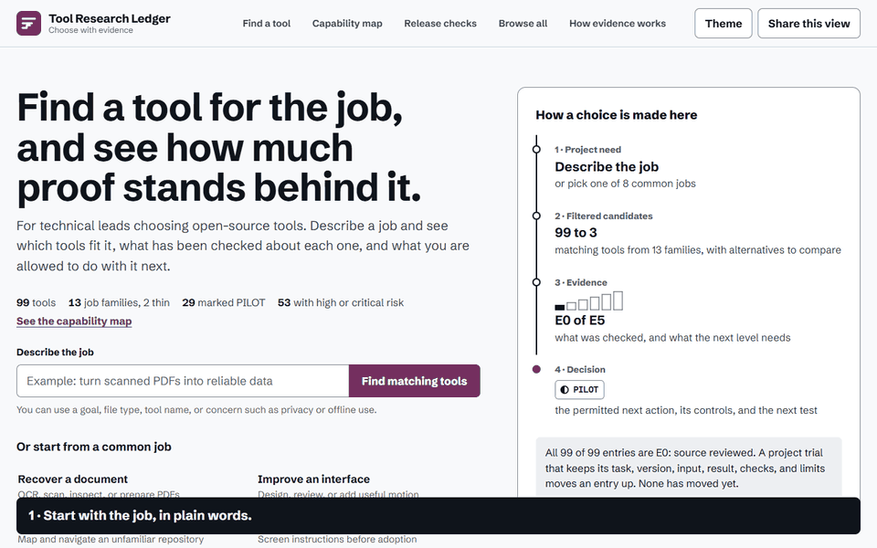
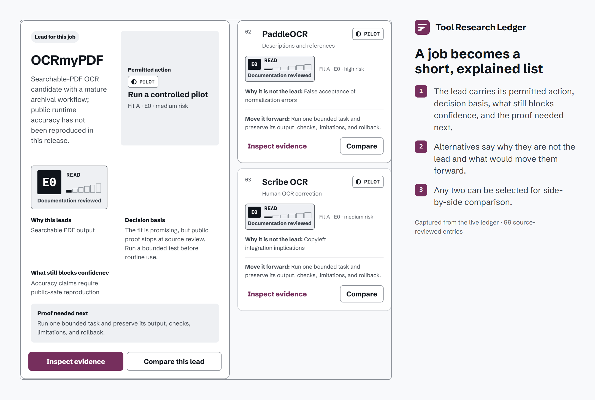
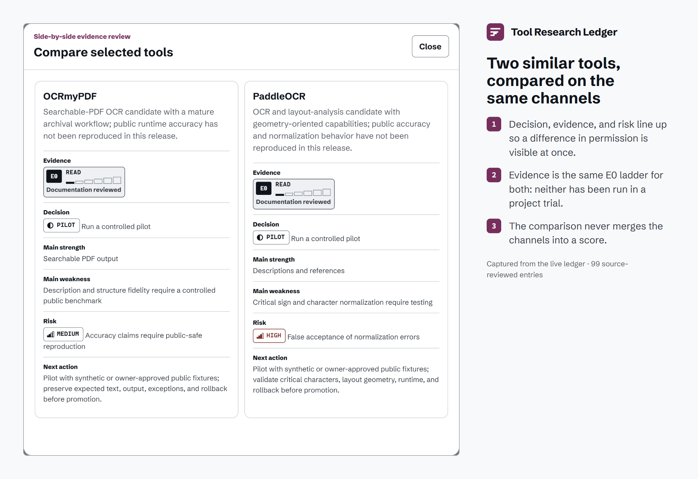
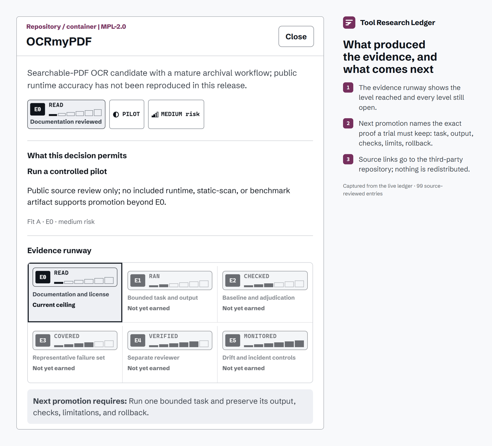
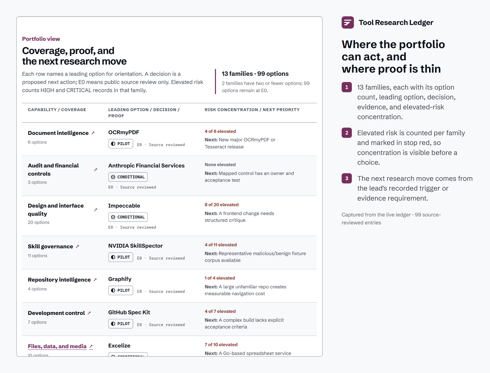

<picture>
  <source media="(prefers-color-scheme: dark)" srcset="docs/brand/hero-dark.png">
  
</picture>

**[Open the live ledger](https://leonelivancortesrodriguez.github.io/tool-research-ledger/)** · [Run it locally](#run-and-verify) · [Evidence model](docs/EVIDENCE_MODEL.md) · [Español](README.es.md)

For technical leads choosing open-source tools: describe a job and see which tools fit it, what has been checked about each one, and what you are allowed to do with it next. Every one of the 99 entries is source-reviewed only (E0), and the interface says so on its first screen.

## The problem

Repository lists rank tools by popularity. They don't say whether a tool fits a particular job, what anyone has actually checked, or what could still stop adoption. Teams then install on the strength of a README and find the risk later.

## See one decision, start to finish

<picture>
  <source media="(prefers-reduced-motion: reduce)" srcset="docs/brand/demo-poster.png">
  
</picture>

A plain-language job becomes three explained candidates. Two of them are compared on the same channels, and the lead's evidence shows exactly what a trial would need to keep. [MP4 version](docs/brand/demo.mp4).

## How a choice is made

`project need → filtered candidates → evidence → decision`

1. **Project need.** Type the job in everyday words, or pick one of eight common jobs.
2. **Filtered candidates.** The ledger narrows 99 tools from 13 capability families to a lead and two alternatives, each with why it isn't the lead and what would move it forward. Any two can be compared.
3. **Evidence.** Each entry shows its level on a six-step ladder, what produced it, and the proof the next level needs.
4. **Decision.** The permitted next action, its basis, its controls, and the next test.

Fit, evidence, decision, and risk answer four different questions, and they never merge into one score:

| Channel | Question | How it is shown |
| --- | --- | --- |
| Fit | How closely does the tool map to the job? | An editorial letter (A to D) with the job it suits; a judgment, never shown as a measurement or merged into a score |
| Evidence | What has been checked? | Six ascending steps, filled to the level reached, with the E-code and a plain label |
| Decision | What may we do now? | A shape plus a verb: ● IMPLEMENT, ◐ PILOT, ⊖ CONDITIONAL, ○ REFERENCE, dashed ○ WATCH, ■ HOLD, ✕ REJECT |
| Risk | What can still stop adoption? | One to four bars plus the word; HIGH and CRITICAL in stop red |

Only two colors carry meaning: berry marks your action and selection, and stop red marks anything that can block adoption.

## Result and evidence

| Status | What it covers | Where to check |
| --- | --- | --- |
| Implemented and tested | Search, guided jobs, capability map, filters and sorting, comparison, evidence detail, shareable URL state, theme switch, keyboard focus, reduced motion | `npm run test:browser` (desktop and 390px mobile) |
| Implemented and tested | Catalog integrity: unique IDs and repository URLs, the 99-repository reconciliation, valid relations, matching JSON and JavaScript copies | `npm test`; `npm run test:mutation` proves a broken evidence scale and a missing source are rejected |
| Source-reviewed | All 99 third-party entries: 29 PILOT, 23 CONDITIONAL, 22 REFERENCE, 10 HOLD, 8 REJECT, 7 WATCH, 0 IMPLEMENT | [`data/catalog.json`](data/catalog.json), [Batch I record](docs/BATCH_2026-10-26-I.md) |
| Planned | Project trials that keep the task, version, input, result, checks, and limits. Only a retained trial can move an entry to E1 or above | [Evidence model](docs/EVIDENCE_MODEL.md) |
| Not claimed | Benchmark scores, safety certification, or operational benefit for any listed tool | No evidence in this repository |

## Product views









## Leonel's role and decisions

**Problem chosen.** Make each tool adoption a decision backed by evidence anyone can inspect.

**Role.** Leonel defined the product goal, set the research and acceptance criteria, curated the repository summaries, and made the final decision on each record. Coding agents helped implement the interface, tests, evidence rules, and release package.

**Decisions that shape it**

- *No composite score.* A single number hides why an option is strong and makes weak evidence look precise.
- *Evidence is a ceiling.* Only retained proof raises a level. Influence on a design, an installation, or a static scan leaves it where it is.
- *Decision is permission.* Each label says what may be done now. A tool can fit well and still be REFERENCE or HOLD.
- *Shape before color.* Every status reads without color.
- *Count from the catalog.* Every number on the page and in these images is derived from `data/catalog.json` at render time.

**Constraints.** Static site with no backend and no runtime dependencies; public repository research only; private trials and internal reports can't raise public evidence.

**Observed results.** Verify, mutation, contrast, prose, browser, privacy, and build checks pass. The catalog reconciles all 99 shared repositories with no duplicate URLs.

**Technologies.** Semantic HTML, CSS with OKLCH tokens, browser JavaScript, the Web Animations API, Node.js scripts, and Playwright Core for development tests.

## Architecture and controls

`catalog.js` supports direct file use, and `catalog.json` gives other tools a machine-readable copy; the verifier requires the two to match. Motion follows the user's reduced-motion preference. See [Evidence model](docs/EVIDENCE_MODEL.md), [Methodology](docs/METHODOLOGY.md), and [Sample decision](docs/SAMPLE_DECISION.md). Read [SECURITY.md](SECURITY.md), [third-party notices](THIRD_PARTY_NOTICES.md), and the [license review](docs/LICENSE_REVIEW.md).

## Limitations

Catalog entries are decision support, not security certification. Every public entry is E0. Fit and project relevance are editorial assessments, not benchmark scores. Links and repository facts can age, and each adoption still needs project-specific legal, security, and operational review.

## Run and verify

Requirements: Node.js 20+ and Chrome, Edge, or a Playwright-compatible Chromium.

```powershell
npm ci
npm run start      # http://127.0.0.1:4173; index.html also works directly
npm run verify     # static, mutation, contrast, prose, browser, privacy, build
```

The build creates a ZIP and SHA-256 inventory under `release/`, excluding Git history, dependencies, test output, and render scratch files. `npm run render` regenerates the README images and demo from the catalog and the live interface; it needs FFmpeg.

## License

The original code and documentation are released under the [MIT License](LICENSE). Schibsted Grotesk is bundled under the SIL Open Font License. Third-party projects keep their own licenses and trademarks.
